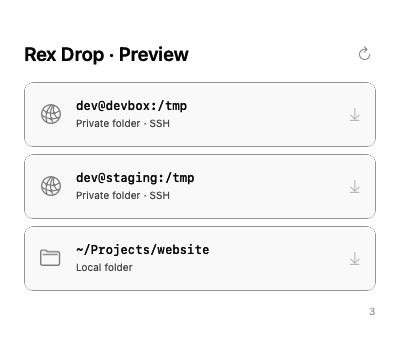
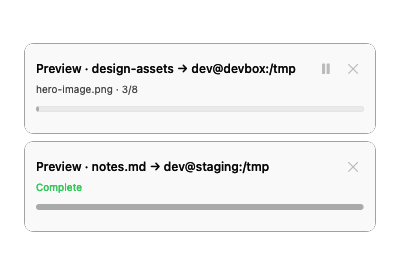

# Rex Drop

A small macOS companion that copies files and folders into a Rex terminal's
working directory, or uploads them to an SSH host and inserts their paths.

Use your ordinary `ssh` command. Rex Drop discovers local Rex panes, inspects
their foreground processes, and recovers an SSH connection from the running
process. It adds a drop zone without changing your shell or Rex configuration.

<p>
  
  
</p>

## Try it

Requires macOS 13+, Rex running locally, and Xcode Command Line Tools to
build. SSH uploads also require `rsync` on the remote host and noninteractive SSH
authentication (keys, an agent, or an existing multiplexed connection).

```sh
git clone https://github.com/rankun203/rex-drop.git
cd rex-drop
./build.sh
./launch.sh
```

The app is built at `.build/Rex Drop.app`. It runs as a menu bar app and does
not add a login item. `launch.sh` replaces the previous running build gracefully;
finish or cancel active transfers before restarting. Quit it from the menu bar
when finished. The destination panel stays hidden until a file drag reaches Rex.

1. Open a local Rex shell or connect normally with `ssh your-host`.
2. Drag files or folders from Finder over a visible Rex window. Available
   destination paths appear beside the pointer: SSH first, then local folders, with
   each group sorted alphabetically. Equivalent destinations appear once.
3. Drop directly onto a destination. The transfer begins immediately and the
   destination list collapses into compact task progress.
4. Pause, resume, cancel, or retry each task independently. A new drag reveals
   destinations while existing tasks continue. Successful transfers insert the
   resulting paths into the captured Rex pane without pressing Enter.
5. ⌘-click a completed card to reveal the copied files in Finder. For SSH,
   it opens a new Rex tab, connects using the captured SSH options, lists the
   upload folder with `ls -ltr` (newest last), and leaves an interactive shell there.

Two tasks can run concurrently. Local progress tracks copied bytes and entries;
remote progress shows the current file's rsync progress. Cancelled or failed
transfers may leave a partial destination; retries start a fresh transfer and
preserve existing local files.

**Show Drop Zone** in the menu bar always opens the window. Automatic reveal is
experimental: it observes the drag pasteboard and visible window geometry using
public macOS APIs. It does not install an event tap or request Accessibility
access. If your macOS version or drag source hides that information, use the
menu bar. Files promised by browsers or Photos are not supported; save them to
Finder first.

## Where files go

| Selected pane | Destination |
| --- | --- |
| Local shell or supported coding agent | Its current working directory |
| Local terminal running SSH | A private `/tmp/rex-drop.XXXXXXXX/` on that SSH host |

Local copies refuse existing destination names. Remote transfers use `rsync`
with a unique destination directory, preserving file and folder names. There is
no delete/synchronization mode. Uploaded temporary directories remain available
for the remote program; remove them when finished or let the host's normal
temporary-file cleanup handle them.

Rex Drop pins the selected pane and process when you drop. It checks them again
before transfer and before inserting paths. A changed directory, process, or
SSH connection requires refreshing the target. Trigger transfers at a prompt
that you want to receive the paths.

## Current scope

- Ordinary SSH connections started inside a local Rex pane, including SSH
  aliases and supported connection flags. Reading process arguments can fail
  for inaccessible or replaced processes; the pane then remains unavailable.
- Native remote Rex sessions and SSH hops started inside an already remote
  shell require additional destination information and are outside this version.
- Each row represents a destination, so you choose by dropping onto the row.
  Its primary label is the local folder path or `user@host:/tmp`; SSH creates a
  private subfolder there for each transfer.
  Duplicate destinations prefer a pane focused in its session's active window,
  with a stable pane-ID tie-break. The row's tooltip identifies that pane.
- Local directory aliases are resolved before deduplication. SSH aliases use
  the effective hostname, user, port, and proxy route from `ssh -G`. If config
  inspection fails, distinct connection arguments stay separate.
- A configured SSH `ProxyJump` works through the recovered connection options.
  SSH authentication prompts are disabled during uploads. Unknown SSH options
  produce an unsupported target rather than a guessed connection.
- The bundled macOS `rsync` is supported; remote hosts need a compatible rsync.
  Transfer failures are reported in the window. A partial remote temporary
  directory can remain after a failure.

## Development

```sh
./test.sh
./build.sh
".build/Rex Drop.app/Contents/MacOS/RexDrop" --self-test
".build/Rex Drop.app/Contents/MacOS/RexDrop" --smoke-test
```

The smoke test opens the UI and exits after 12 seconds without transferring
anything. `".build/Rex Drop.app/Contents/MacOS/RexDrop" --targets` is a read-only
JSON inspection command. The app reads process arguments only for a local process Rex identifies as SSH;
full arguments are never returned in the target list.

`./smoke.sh` is an opt-in live integration test. It creates a disposable local
Rex session, copies a temporary file and folder, verifies path insertion, and
removes that session and its test files. Existing panes stay untouched.

The app is written entirely in Swift using AppKit, Foundation, and macOS process
APIs. `build.sh` compiles a standalone executable and ad-hoc signs the app. There are
no telemetry, background services, shell aliases, or configuration hooks.

## License

MIT. This is an independent companion and is not affiliated with Superlogical.
